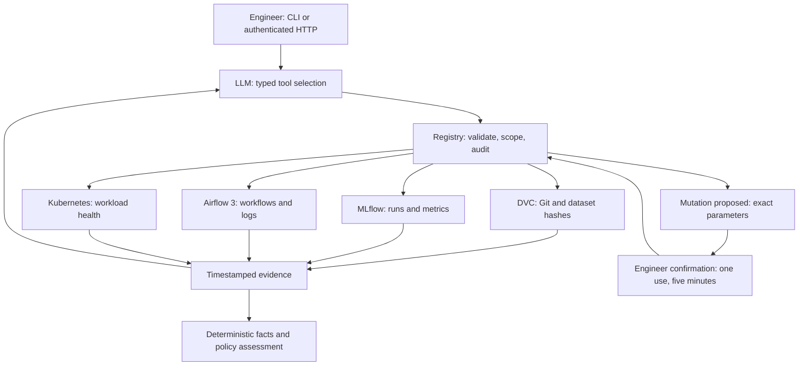

# System architecture

The LLM chooses tools and follows evidence across services. It cannot supply executable shell
commands, change namespaces, authorize its own actions or fabricate the final operational report.
The response includes facts derived directly from tool results, uncertainties and policy-based
recommendations. Each evidence envelope carries a request ID, observation timestamp and status.

## Data and model flow

1. Canonical Iris CSV is DVC-tracked; the pointer belongs to a Git commit.
2. Validation checks schema, missing values, feature bounds, labels, hash and clean tracked source.
3. A seeded stratified 80/20 split isolates held-out evaluation data. Scaling fits training rows only.
4. Logistic regression is trained; evaluation logs parameters, macro F1, accuracy, model artifact,
   source commit, dataset hash, pointer and Airflow run to MLflow.
5. The quality gate records its threshold and decision. Only passing runs receive an approved bundle.
6. An explicit deployment script builds a model-specific image and deploys two prediction replicas.
   The Pod template records the MLflow run ID; /version returns dataset provenance.

## Isolation and permissions

The adapter registry is the only conversational execution path. Pydantic rejects additional or
malformed arguments. DVC subprocesses use a fixed argv without a shell and validate revisions and
paths. Airflow permits training only for iris_training. Kubernetes operations are restricted to
mlops and prediction-api; pod logs also verify the application label. Kubernetes RBAC independently
provides read-only and optional narrowly scoped restart identities.

The planner cannot pass an authorization boolean. A separate authenticated confirmation exchange
stores the exact validated action server-side, binds it to the caller, expires it after five minutes,
and consumes it before execution. State-changing operations are not automatically retried. A queued
DAG run and an accepted restart are acknowledgements, not successful completion claims.

## Reliability and observability

HTTP clients, SDK calls and DVC subprocesses have bounded timeouts. Service failures produce empty
data with error/timeout status. Planner rounds and duplicate tool invocations are bounded. Airflow
retries each stage once and uses default all-success dependencies. Concurrent DAG runs are limited
to one; artifacts are isolated by a hash of the run ID. Logs record tool name, status, duration and
request ID without raw arguments, authentication headers or payloads.

## Reproducibility

Direct Python package versions, service image versions and inference numerical-library versions
are pinned. DVC pointers bind data bytes to source commits. Fixed random seeds reproduce the split
and training procedure. A clean source check prevents recording an inaccurate code commit. Local
DVC remote configuration and all generated secrets stay outside Git. Model hashes detect accidental
bundle corruption; they do not make arbitrary pickle files safe to load.

## References

- https://airflow.apache.org/docs/apache-airflow/3.0.1/stable-rest-api-ref.html
- https://airflow.apache.org/docs/apache-airflow/3.0.1/core-concepts/auth-manager/simple/index.html
- https://mlflow.org/docs/2.22.0/python_api/mlflow.client.html
- https://dvc.org/doc/command-reference/diff
- https://kubernetes.io/docs/tasks/configure-pod-container/configure-liveness-readiness-startup-probes/
- https://scikit-learn.org/stable/modules/generated/sklearn.datasets.load_iris.html
